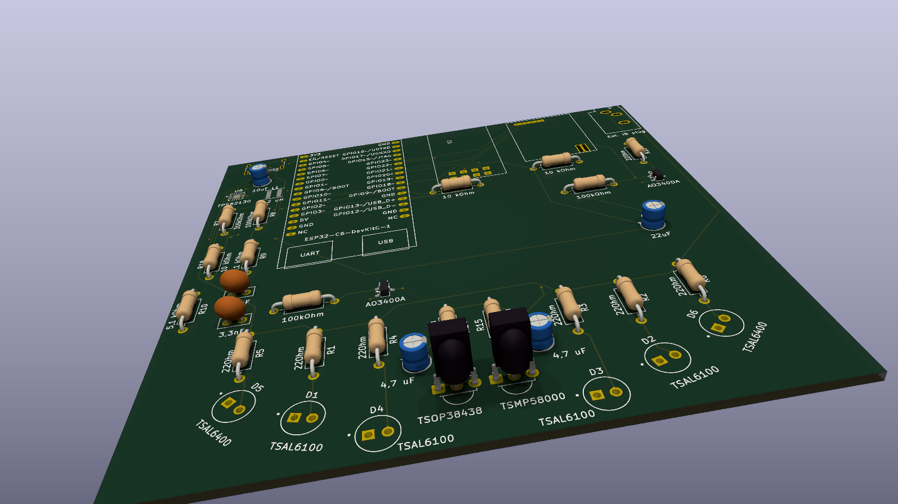

# ComMANYcator
An esp32 based project, capable of communicating with IR, and RF

**Hello, and welcome to my project, ComMANYcator. This project is made for Hack Club's Half-life event.**
## Why did I make this project?
For years, i have been in war with the many remotes I have in my home. So I decided to make a change, and fabricate this project, wich uses IR blasters and recievers, and two RF moudles (on 433Mhz and 868Mhz)

The project uses the main parts below:
- ESP32 C6 DevboardC-1
- 2x CC1101 RF modules from alliexpress
- TSAL 6100 & 6400 IR leds
- TSOP 38438 & TSMP 58000 IR recievers
- TPS 62130 5v to 3.3v converter

## The Schematic design

This is the final scmeatic for the pcb. In the top left corner is the usb-c and 5v to 3.3v converter region (so power region.)
In the bottom left corner are the IR LEDs and an external port for commercial IR blasters.
In the middle, is the brain of the project, the esp32 c6.
Below and right of the esp are the RF modules.
Above the esp are the IR recievers.

## The pcb layout & wiring

This is the final layout design, and the routing done. 

### LEDs:

Blue represents TSAL6400 at 45°, Red represents TSAL6100 at 0° in the middle, and 15° in the middle

## Software
Software is based on ESPhome, and it is hypothetical, as I cannot test it.

**Installation guide**
1. Install esphome device builder (https://esphome.io/install/)
2. Create and name a new project
3. Edit the .yaml file to match DEMO.yaml (change pins, codes, passwords etc)
4. Write to esp

#IMPORTANT
- I did not make Esphome.
- I cannot test the software, so this is hypotethical. When i recieve it, I'll make a v2!!!!

BOM: in bom.csv
